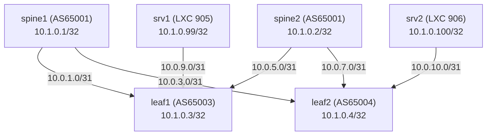

# Дизайн IP CLOS fabric на SONiC

Ціль: мінімальна, але повноцінна IP CLOS топологія (dual spine / dual leaf) для
відпрацювання SONiC: eBGP underlay, ECMP, reachability кінцевиків, репродуктивна
конфігурація через `config_db.json` + oneshot. Кінцевики — два мінімальні busybox
LXC (PVE CT), по одному за кожним leaf.

> **Статус (2026-11-17):** 4 VM up, **BGP 8/8 Established**; **LXC 905/906
> running (Task 5)** — `scripts/create-lxc-servers.sh` (reproductive).
> **Фабрика верифікована:** inter-leaf (leaf1↔leaf2) + srv1↔srv2 — 0% loss;
> ECMP x2 на обох leaves (2 kernel nexthops); spine → всі data-кінцевики OK.
> Root-причини попереднього блокера розкрито (AFI + zebra FIB-hang) і
> закріплено в `fabric-vnet.sh` (див. «BGP-дизайн»). Spine↔spine Lo0 —
> недосяжно by design (немає spine–spine линку).

## Топологія

2 spines + 2 leaves. Кожна spine пов'язана з кожним leaf **одним** L2-каналом
(P2P bridge на PVE хості) → **4 активні /31 линки** у fabric (spine1↔leaf1,
spine1↔leaf2, spine2↔leaf1, spine2↔leaf2). Решта bridges (`*b`) — інертні
рештки початкового 8-лінкового дизайну: без IP, лишаються як є.
Сервери: `srv1` за leaf1, `srv2` за leaf2 (single-homed), без mgmt NIC.

> **Рішення про 4 линки (2026-11-13, approve):** два лінки на spine–leaf пару
> для P2P-з'єднання не потрібні — достатньо одного. 4 линки = мінімальна
> повна spine↔leaf топологія. ECMP x2 досягається на рівні **leaf** (2 spines),
> а не на рівні одного spine–leaf link.

## Адресація / AS plan

### Loopback (BGP RIB) + інвентар пристроїв

> **ПРАВИЛО:** оперувати за **оперативною роллю + mgmt IP**, НЕ за PVE name/VMID.
> PVE VM 903 ("sonic-leaf1") = operationally **leaf2** (145); PVE VM 904
> ("sonic-leaf2") = operationally **leaf1** (199) — **names swapped**.

| Роль | PVE ID | PVE name | Тип | Mgmt IP | Loopback0 | BGP AS |
|------|--------|----------|-----|---------|-----------|--------|
| spine1 | 901 | sonic-spine1 | VM | 192.168.1.247 | 10.1.0.1/32 | 65001 |
| spine2 | 902 | sonic-spine2 | VM | 192.168.1.82 | 10.1.0.2/32 | 65001 |
| leaf1 | 904 | sonic-leaf2 ⚠️ | VM | 192.168.1.199 | 10.1.0.3/32 | 65003 |
| leaf2 | 903 | sonic-leaf1 ⚠️ | VM | 192.168.1.145 | 10.1.0.4/32 | 65004 |
| srv1 | 905 | lab-srv1 | CT | — (pct exec) | 10.1.0.99/32 | — |
| srv2 | 906 | lab-srv2 | CT | — (pct exec) | 10.1.0.100/32 | — |

> **AS re-plan (2026-11-16, approve):** leaf1 65002→**65003**, leaf2
> 65002→**65004** (частина фікса AS-path loop); spines лишаються 65001.
> Джерело істини: `configs/sonic-*/config_db.json` (`bgp_asn`).

### P2P links (/31) — 4 fabric + 2 server

| Bridge (PVE host) | Пристрій A (IP) | Пристрій B (IP) |
|-------------------|-----------------|-----------------|
| br-c-s1l2a | spine1 10.0.1.0/31 | leaf1 10.0.1.1/31 |
| br-c-s1l1a | spine1 10.0.3.0/31 | leaf2 10.0.3.1/31 |
| br-c-s2l2a | spine2 10.0.5.0/31 | leaf1 10.0.5.1/31 |
| br-c-s2l1a | spine2 10.0.7.0/31 | leaf2 10.0.7.1/31 |
| br-c-l2srv | leaf1 10.0.9.0/31 | srv1 10.0.9.1/31 |
| br-c-l1srv | leaf2 10.0.10.0/31 | srv2 10.0.10.1/31 |

> **srv bridge quirk:** `br-c-l2srv` фізично на leaf1 (carries srv1), а
> `br-c-l1srv` — на leaf2 (carries srv2). Назви мостів переставлені відносно
> ролей (наслідок swap PVE name 903/904).

Management: SONiC VM — окремий NIC на `vmbr0`, DHCP (router 192.168.1.1);
mgmt IP зафіксовані в `inventory/fabric.yaml`. LXC — без mgmt NIC, керування
через `pct exec` / PVE console.

## BGP-дизайн

- eBGP: spine (65001) ↔ leaf1 (65003) / leaf2 (65004), сусіди = P2P-адреси /31.
- `maximum-paths 2` — через oneshot `fabric-vnet.service` (FRR-зміні ephemeral;
  plain `maximum-paths 2` вмикає eBGP multipath — keyword `maximum-paths ebgp`
  в цьому FRR відсутній, `maximum-paths ?` → лише число/`ibgp`).
- Spine анонсує: свій loopback /32 (render `network` + `redistribute connected`).
- leaf анонсує: свої statics через vtysh (`redistribute static` + `network`):
  leaf1 — `10.1.0.3/32`, `10.0.9.0/31`, `10.1.0.99/32` (srv1);
  leaf2 — `10.1.0.4/32`, `10.0.10.0/31`, `10.1.0.100/32` (srv2).
- **ECMP x2 (leaf → через 2 spines) — верифіковано** (2 kernel nexthops,
  див. «Поточний стан»). Spine → leaf/srv — 1 next-hop (1 линка на пару);
  spine↔spine Lo0 — недосяжно by design (немає spine–spine линку, leaves не
  ре-анонсують eBGP Lo0-рути).

### AFI pitfall (root-причина блокера, 2026-11-16)

bgpcfgd render (standard template) містить `no bgp default ipv4-unicast` →
v4-neighbor'и, додані через vtysh, створюються **без активованого AFI**:
`show ip bgp summary` друкує `% No BGP neighbors found in VRF default`
(**мілливник** — neighbor'и існують!), state = Idle, Opens = 0. Глобальний
`bgp default ipv4-unicast` НЕ retro-активує вже створених peer'ів
(FRR 10.7.1) → необхідний явний per-neighbor `activate`:
`address-family ipv4` → `neighbor <ip> activate` → `exit-address-family`.
Закріплено у vtysh-блоці всіх 4 `fabric-vnet.sh`.

### zebra FIB-hang

Симптом: BGP RIB наповнений (PfxRcd > 0), зebra RIB = `Status: Failed`
(nexthops `r`, не `*`), kernel FIB = 0 BGP-маршрутів. Зустрічався на spine2
(фікс 2026-11-15) та leaf2 (фікс 2026-11-17): `sudo docker restart bgp` +
re-run `fabric-vnet.sh` → `Status: Installed` (zebra re-розв'язує nexthop'и
на вже UP-інтерфейсах). Перевірка: `show ip route <prefix>` → `Status:` +
`ip -4 route | grep bgp`.

## Поточний стан (2026-11-17) — верифіковано

**Сесії:** 8/8 Established (spines 65001, leaf1 65003, leaf2 65004).
**PfxRcd:** leaf: 7/spine (PfxSnt 12); spine: 5/leaf (PfxSnt 11). RIB:
leaf 12 entries, spine 11 entries.

**Verify matrix (ping, 2026-11-17):**

| Шлях | Результат |
|------|-----------|
| srv1 (905) ↔ srv2 (906) Lo0 | ✅ 0% loss (cross-leaf, через spines) |
| srv1/srv2 → spine1/spine2 Lo0 | ✅ 0% loss (4 комбінації) |
| leaf1 ↔ leaf2 Lo0 | ✅ 0% loss (inter-leaf) |
| leaf1/leaf2 → spine1/spine2 Lo0 | ✅ 0% loss |
| spine1/spine2 → leaf1/leaf2 Lo0 | ✅ 0% loss |
| spine1/spine2 → srv1/srv2 Lo0 | ✅ 0% loss |
| spine1 ↔ spine2 Lo0 | ❌ **by design** — немає spine–spine линку; leaves не ре-анонсують eBGP Lo0-рути (no `redistribute bgp`) |

**ECMP x2 (verified, kernel FIB):**
- leaf1 `10.1.0.4`: `nexthop via 10.0.1.0 dev eth1` + `via 10.0.5.0 dev eth3`
- leaf2 `10.1.0.3`: `nexthop via 10.0.3.0 dev eth1` + `via 10.0.7.0 dev eth3`
- BGP RIB: `Paths: (2 available, best #1)`, обидва nexthops `multipath`;
  зebra RIB `Status: Installed` (nexthops `*`).

> **Після кожного re-render** (HSET CONFIG_DB / `docker restart bgp`) файл
> знову render-only → обов'язковий re-run `/usr/local/lib/fabric-vnet.sh`
> (neighbor'и + AFI + networks + multipath + redistribute static).

## Pivot: kernel-fabric (SAI dark)

SONiC-vs: SAI TAP'и (`Ethernet0/4/8/12/16…`, shared MAC `22:16:7c:6a:bc:c7`,
MTU 9100) — data plane **dark by design** в цьому lab. Причина: vs-sai
AF_PACKET DGRAM self-re-ingest → L2 flood (~53k/s) при активних TAP;
down Ethernet0/f0 вимикає шторм. Фабричний трафік іде через **kernel-рівень**
(guest bridge `Bridge` + vnet + PVE bridges), не через SAI ASIC. Це
фундаментальна обмеження vs-моделі, а не баг конфігу.
**Ніколи** не виставляти IP на SAI TAP'и (ARP seed → шторм).

## KSM

- `/etc/systemd/system/ksm.service` (oneshot, `run=1`) — створено, enabled.
- `ksmtuned` (від PVE) **masked** (`stop+mask`, approve) — інакше скидає `run=0`
  при вільній пам'яті. Verify: `run=1` стабільно. Не чіпати.

## Платформа PVE (192.168.1.19, PVE 9.2.26)

- CPU: 12 × AMD Ryzen 5 PRO 5650U; RAM: **11.3 GB** + **8 GB swap**
  (2026-11-12 перевірено: MemAvailable ≈ 9.7 GB, load ≈ 0.06).
  → **Бюджет**: 8 GB (SONiC) + 0.5 GB (LXC) + ~1 GB host + ≤1 GB CT100 ≈
  10.5 GB / 11.3 GB + 8 GB swap як safety-net. Fallback: SONiC → 1.5 GB.
- VM 101 (win10, 8 GB) — stopped, 0 usage; CT 100 (VictronBLE) — ≤1 GB + 1 GB swap.
- Storage: `local-lvm` (lvmthin, ~329 GB free) — диски VM qcow2, thin; LXC —
  rootfs (busybox ~1 MB / optional minimal Debian ~100 MB).
- Мережа: ifupdown (`/etc/network/interfaces`), нові bridges →
  `/etc/network/interfaces.d/<bridge>` (stanza `inet manual`, `bridge_ports none`).
  **Бridges ad-hoc: НЕ переживають reboot PVE** — після reboot recreate.
- OVMF roms **відсутні** → SeaBIOS (SONiC vs image завантажуваний SeaBIOS;
  fallback: `apt install qemu-ovmf-pve-boot`).
- Вільні ID: VM 901–904, CT 905–906 (існують 100 CT, 101 win10 VM).

## LXC-сервери (busybox) — створені (Task 5, 2026-11-15)

- Тип: PVE CT (LXC), 1 vCPU / 256 MB RAM. Скрипт: `scripts/create-lxc-servers.sh`
  (reproductive; виконується на PVE-хості root'ом).
- Rootfs: мінімальний busybox — **dynamic-linked** (host) → скрипт копіює libs
  (`libc.so.6`, `libresolv.so.2`) + `ld-linux-x86-64.so.2` у rootfs; tar ~1.5 MB.
  Понад busybox:
  - **немає `ifupdown`** → PVE не підніме інтерфейс автоматично; IP/маршрут
    прописуємо в init (busybox `ip`), персистентність — `/etc/init.d/rcS`
    (**idempotent**: flush addrs/route перед re-apply → безпечний re-run).
- Мережа: 1 NIC (`lxc.net.0`) на свій P2P bridge. Мgmt без NIC — `pct exec`.
- Стан: 905 lab-srv1 (br-c-l2srv, 10.0.9.1/31, gw 10.0.9.0, lo 10.1.0.99/32) —
  running; 906 lab-srv2 (br-c-l1srv, 10.0.10.1/31, gw 10.0.10.0,
  lo 10.1.0.100/32) — running. Evidence — таблица «LXC end-to-end» вище.
- Fallback (не спрацював): minimal Debian rootfs через `debootstrap` (~100 MB)
  з ifupdown — busybox CT стартує стійко.

### PVE 9 LXC quirks (виявлено в Task 5)

- **`pct create` НЕ має top-level `--name`** (існує лише `name` у netconf). Якщо
  передати `--name`, Getopt зсувається і псує `--nameserver` → 400
  «invalid format». Display-назва CT == `hostname` (параметр `--hostname`).
- **`unmanaged` template: PVE НЕ пише `/etc/hostname`** (пише лише для
  ostype-specific template). → обидва CT стартують з дефолтом template
  (lab-srv1). Фікс: після `pct start` → `pct exec <id> -- sh -c "echo <name> >
  /etc/hostname"` + re-run idempotent `/etc/init.d/rcS`.
- **`pct exec` ковтає будь-який аргумент з тире** (`-c`, `-W`, навіть `sh -c`)
  → 400 «unable to parse option». Фікс: separator `--`: `pct exec <id> -- ping
  -c2 -W2 <ip>`. Виконання скрипта без тире працює: `pct exec <id>
  /etc/init.d/rcS`.
- **Відносний symlink `/sbin/init -> busybox` — зламаний** (вказує на
  відсутній `/sbin/busybox`) → `Failed to spawn container`. Фікс: абсолютний
  `ln -sf /bin/busybox sbin/init`.

## Підхід до конфігурації SONiC

- Джерело істини: `config_db.json` на пристрій (repo: `configs/<dev>/config_db.json`).
- Apply: `config load -y <json> && config save -y` → reboot (BGP-демони читають
  config_db на старті).
- `config load` **merges, не remove** stale keys → scan+DEL після кожного load.
- FRR-змін через vtysh **ephemeral**: bgpcfgd перерендерить per-daemon conf'и з
  CONFIG_DB при зміні DEVICE_METADATA або (re)start контейнера `bgp` (BGP_NEIGHBOR-
  зміна render НЕ триггерить) → персистентність neighbor'ів/AFI/networks/
  `maximum-paths`/`redistribute static` = oneshot `fabric-vnet.service` (wait-loop
  до `show ip bgp summary | grep -E "BGP router identifier|No BGP neighbors"`,
  потім apply; re-run обов'язковий після будь-якого HSET / `docker restart bgp`).
- `DEVICE_METADATA.type` = `LeafRouter` — **ніколи не змінювати** (is_chassis() crash).
- `maximum-paths` у `constants.yml` дефолт 514 (FRR відхиляє) → sed 514→2 на
  всіх 4 VM (done 2026-11-13); fabric-vnet.sh теж ставить `maximum-paths 2`
  (idempotent; plain форма вмикає eBGP multipath в цьому FRR — keyword `ebgp`
  відсутній).
- Розсилок: spine — render `network` (own Lo0) + `redistribute connected`;
  leaf — vtysh-блок: `network` (P2P/srv /31) + `redistribute static`
  (`STATIC_ROUTE` з `config_db.json`: srv Lo0 + srv p2p).

## Documentation Output (reference-standards)

Структура docs — за skill `evpn-fabric` (використаний лише як reference для
структури документації; EVPN/VXLAN overlay в цій лабораторії **відсутній**):

- **Node inventory** → `inventory/fabric.yaml` + таблиця вище.
- **Link map** → `inventory/fabric.yaml` (`links`) + таблиця /31 вище.
- **Full running configs** → `docs/running-configs.md` (evidence snapshot
  2026-11-14); source of truth — `configs/<dev>/config_db.json`.
- **Teardown** → `runbooks/00-destroy.md`.

## Out of scope / follow-up

- ~~Розкрити inter-leaf блокер~~ — **DONE (2026-11-17)**: root cause = AFI +
  zebra FIB-hang; фікси в `fabric-vnet.sh` + `docker restart bgp` (див. вище).
- LXC 905/906 busybox + end-to-end (Task 5).
- IPv6 underlay, PFC/ECN, sFlow, SNMP-агенти, Zabbix-інтеграція.
- BGP на серверах, route-map/community, dual-homed сервер.
- EVPN/VXLAN overlay — **не в цій лабораторії** (L3-only); якщо потрібно —
  окремий scope/pivot (CML/IOS-XE або адаптація на SONiC).
- Збільшення fabric (4+ leaf'i) — модель масштабується 1:1.
